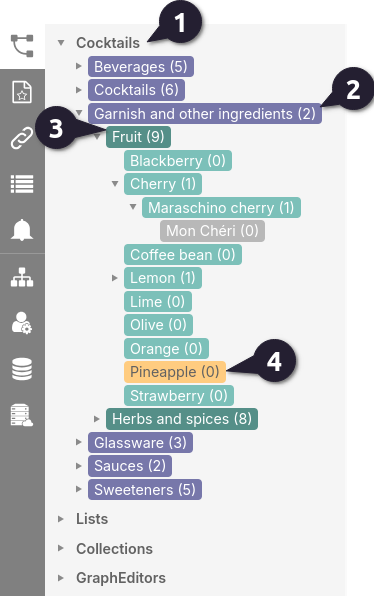
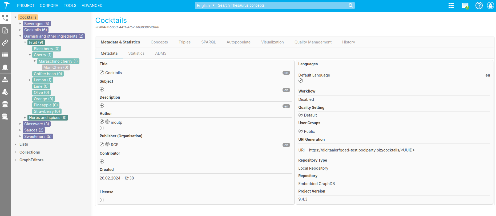
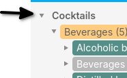
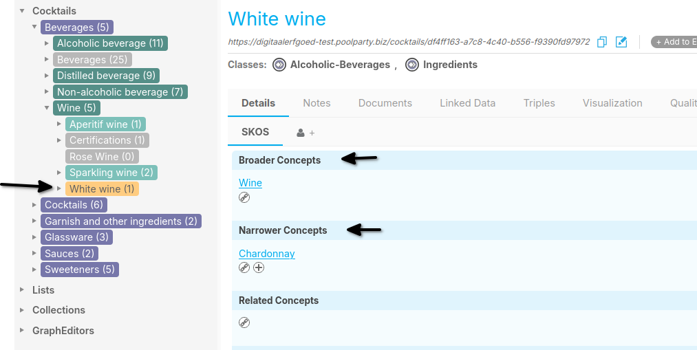
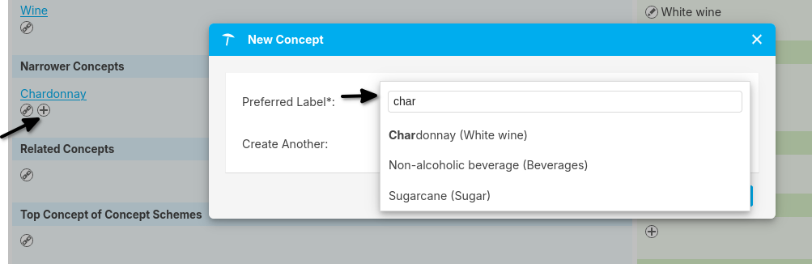
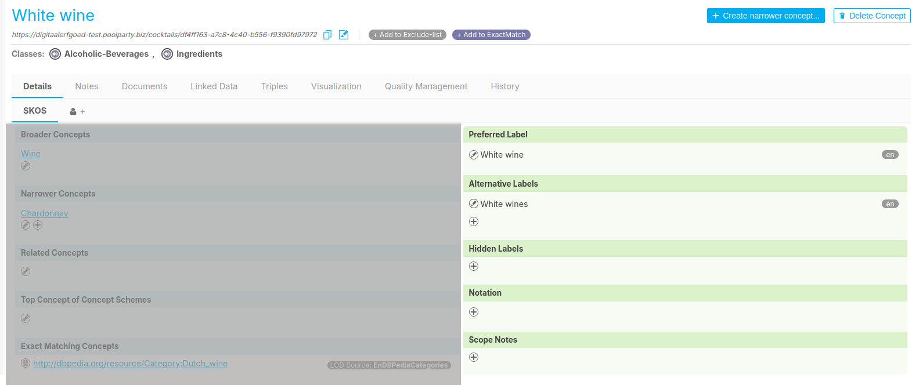
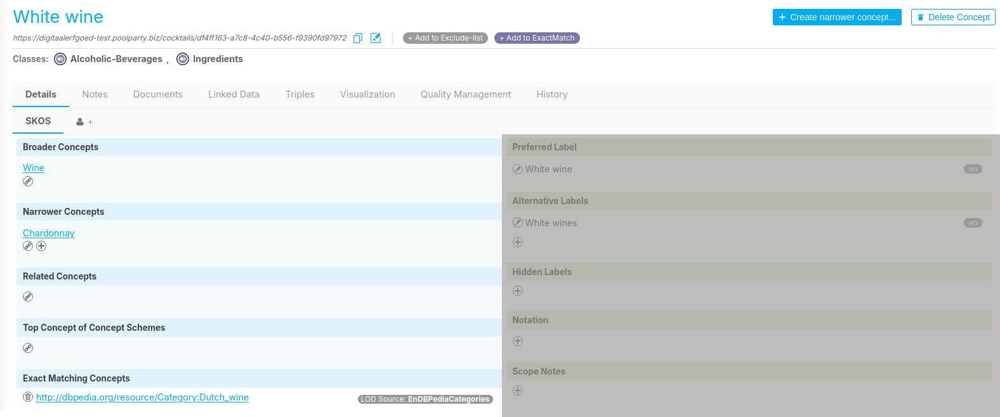

{: .no_toc .text-delta }

<!-- Overlay (only once) -->

  
  

# Opbouw van een SKOS-thesaurus

In PoolParty beheer je **concepten**: de begrippen in jouw thesaurus. Je geeft elk concept namen, een toelichting en relaties met andere concepten. **SKOS** is de standaard waarmee je deze gegevens vastlegt.

Een term is een naam voor een concept. In de begrippenboom zie je die naam, maar als je erop klikt open je het concept met al zijn gegevens. Deze handleiding gebruikt **concept** voor het begrip en **label** of **naam** voor de benaming.

## De begrippenboom (Hierarchy Tree)

Links zie je het project, de begrippenschema’s en de concepten. De onderstaande afbeeldingen gebruiken de **Cocktails Thesaurus** als voorbeeld.

### Project

Het project bevat jouw thesaurus en de bijbehorende instellingen. Selecteer het project om de projectgegevens te bekijken.

### Begrippenschema (Concept Scheme)

Een begrippenschema groepeert concepten. De hiërarchische relaties liggen tussen de concepten. Het schema zelf is geen breder begrip.

Een **custom scheme** biedt extra klassen, relaties en attributen. Dat is iets anders dan een begrippenschema. Lees hierover bij [Custom Schemes]().

### Topconcept (Top Concept)

Een topconcept is een toegangspunt van een begrippenschema. Een schema kan meerdere topconcepten hebben. In de boomweergave staan die onder het schema.

### Concept (Concept)

Een concept kan smallere begrippen hebben en onder één of meer bredere begrippen vallen. Bij meerdere bredere begrippen spreken we van **polyhiërarchie**. Lees verder over [hiërarchie en polyhiërarchie]().

## Een concept vinden

Zoek op een naam via het zoekvak, of blader door de boom. Met de pijltjes naast een concept klap je de onderliggende concepten uit.

Klik op een concept. De gegevens verschijnen rechts in het detailvenster (**Details View**).

## Concepten verbinden

Gebruik **Broader Concepts** voor bredere begrippen en **Narrower Concepts** voor smallere begrippen. Klik op het kettinkje om een bestaand concept te kiezen. Via automatisch aanvullen (**Autocomplete**) zoek je de juiste naam.

Je kunt een bestaand concept ook vanuit de boom naar het passende relatieveld slepen. Controleer daarna of de relatie de bedoelde richting heeft.

Een andere naam voor hetzelfde begrip voeg je toe als alternatieve naam, niet als relatie naar een nieuw concept.

## Namen en teksten invoeren

De velden voor namen en teksten staan in het detailvenster. De plaats van de velden hangt af van jouw weergave en projectinstellingen.

- **Voorkeursnaam (Preferred Label)**: de gekozen naam van het concept, één per taal.
- **Alternatieve naam (Alternative Label)**: een andere naam voor hetzelfde begrip.
- **Zoeknaam (Hidden Label)**: een naam die je voor zoeken gebruikt en normaal niet toont.
- **Toelichting (Scope Note)**: een tekst over de betekenis of het gebruik van het begrip.
- **Definitie (Definition)**: een omschrijving van de betekenis.

Klik op het **plusteken** om een waarde toe te voegen. Klik op het **pennetje** om een bestaande waarde te wijzigen. De **x** verwijdert de betreffende waarde. In de standaardtaal kun je de enige voorkeursnaam niet verwijderen.

Met de omwisselpijltjes kun je een alternatieve naam en de voorkeursnaam omwisselen. Controleer daarna welk label in welk veld staat. Kies bij elke invoer de juiste projecttaal.

Geeft PoolParty een invoerwaarschuwing? Lees de melding en controleer de waarde volgens de projectafspraken.

## Relaties bekijken

In de relatievelden zie je de verbindingen met andere concepten, bijvoorbeeld bredere en smallere begrippen of koppelingen naar een andere thesaurus.

De SKOS-namen zoals `skos:broader` en `skos:prefLabel` beschrijven deze velden in de gegevens. Je vindt de Nederlandse betekenis en de Engelse schermnaam in de [begrippenlijst]().

## Zelf oefenen

- [Je eerste concept](): maak een begrip en voeg een toelichting toe.
- [Een bestaand concept aanpassen](): wijzig een naam en bekijk de geschiedenis.
- [Invoerafspraken](): kies het juiste veld voor jouw tekst.

Bron: [Graphwise 10.1: Editing Details](https://help.graphwise.ai/pp10.1/en/graph-modeling/ontology-management/working-with-concept-schemes-and-concepts/editing-details.html).
