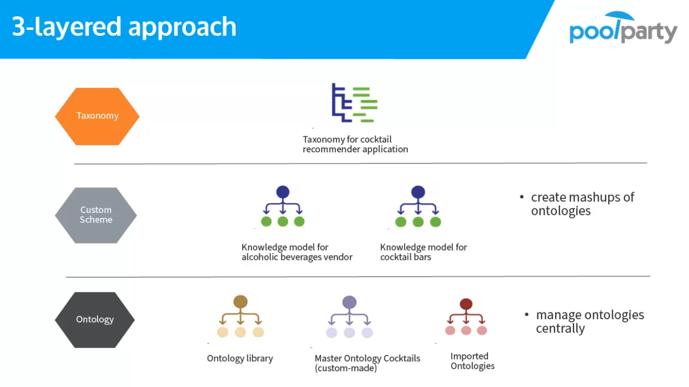
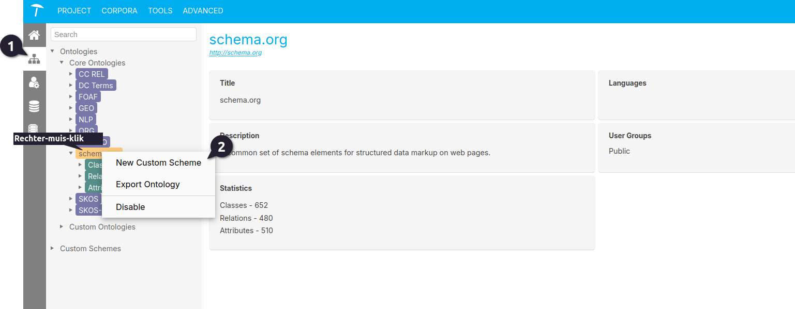
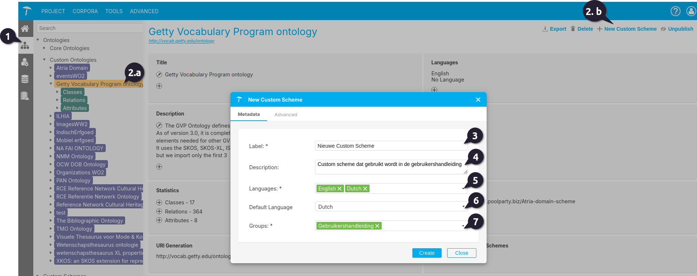
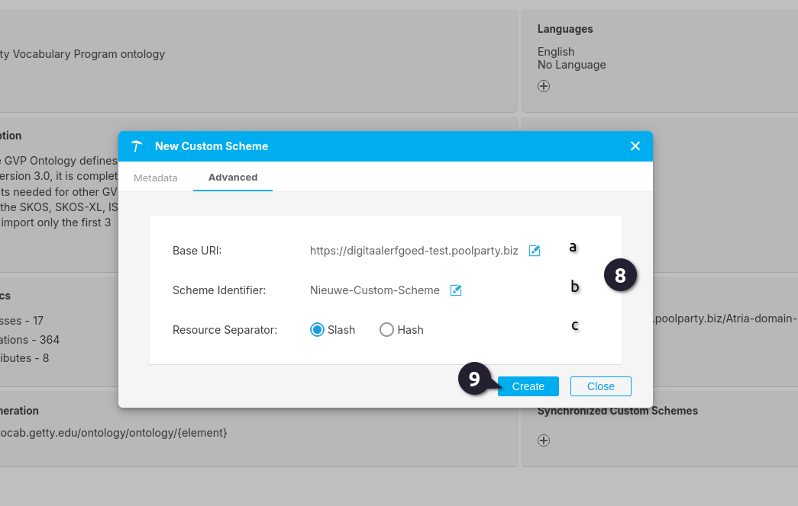
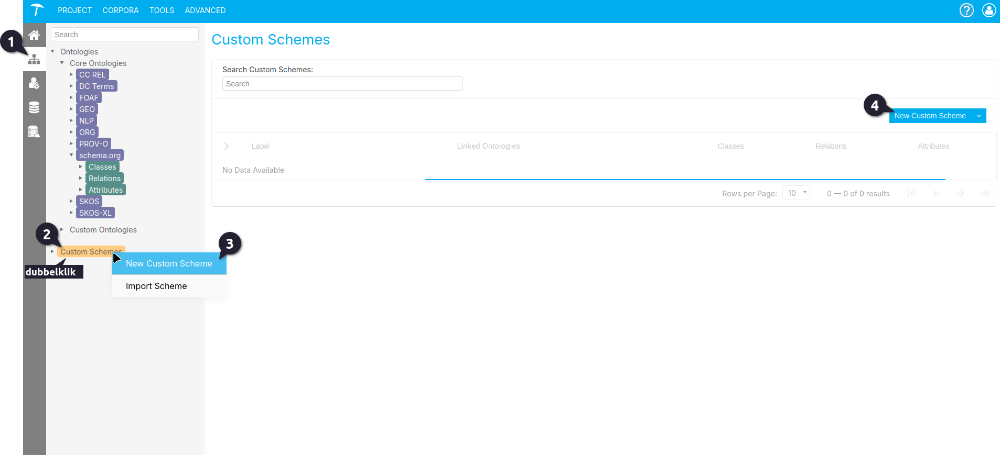

{: .no_toc .text-delta }

<!-- Overlay (only once) -->

  
  

# Custom Schemes

Met een custom scheme kies je welke klassen, relaties en attributen uit ontologieën je wilt gebruiken. Daarmee kun je begrippen in jouw thesaurus aanvullende gegevens geven.

Een **concept scheme** groepeert begrippen in je thesaurus. Een **custom scheme** biedt extra mogelijkheden om die begrippen te beschrijven. De namen lijken op elkaar, maar de functies verschillen.

Begin je net met PoolParty? Leer eerst hoe je concepten, labels en relaties beheert. Een custom scheme maak je pas wanneer de bestaande velden niet volstaan. Bespreek de inrichting met de RCE PoolParty-beheerder. Voor de stappen hieronder heb je toegang tot **Ontology Management** en de juiste bewerkrechten nodig.

## In dit hoofdstuk

1. [Een custom scheme maken vanuit een ontologie](#vanuit-ontologie)
2. [Een leeg custom scheme maken](#leeg-schema)
3. [Het overzicht bekijken](#overzicht)
4. [Een taal toevoegen](#taal)
5. [Een gebruikersgroep toevoegen](#gebruikersgroep)
6. [Onderdelen toevoegen via autocomplete](#autocomplete)
7. [Onderdelen toevoegen vanuit een ontologie](#onderdelen)
8. [Een custom scheme verwijderen](#verwijderen)
9. [Het schema gebruiken in een project](#project)

## 1. Een custom scheme maken vanuit een ontologie
{: #vanuit-ontologie }

1. Open **Ontology Management** via de werkbalk.
2. Kies onder **Core Ontologies** of **Custom Ontologies** de ontologie die je wilt gebruiken. Klik erop met de rechtermuisknop en kies **New Custom Scheme**. SKOS en SKOS-XL zijn voor deze handeling uitgezonderd.

3. Vul een titel in en eventueel een beschrijving.
4. Kies de talen voor labels en beschrijvingen. Bij meerdere talen kies je ook een standaardtaal.
5. Wijs de gebruikersgroepen toe die toegang moeten krijgen.

6. Controleer zo nodig onder **Advanced** het URI-patroon. Gebruik de afspraken van jouw organisatie voor de basis-URI, schema-ID en het scheidingsteken. Zie [URI-patroon instellen](https://help.poolparty.biz/en/user-guide-for-knowledge-engineers/advanced-features/ontology-management/create-and-manage-ontologies/define-the-uri-pattern-for-a-custom-ontology-or-custom-scheme.html).
7. Klik op **Create**. Je vindt het schema onder **Custom Schemes**.

[Officiële uitleg: schema maken vanuit een ontologie](https://help.poolparty.biz/en/user-guide-for-knowledge-engineers/advanced-features/ontology-management/create-and-manage-custom-schemes/create-custom-schemes-from-an-ontology.html)

## 2. Een leeg custom scheme maken
{: #leeg-schema }

1. Open **Ontology Management**.
2. Selecteer **Custom Schemes** in de boom links.
3. Klik rechts op **New Custom Scheme**. Je kunt ook dubbelklikken op **Custom Schemes**, of via de rechtermuisknop **Create Scheme** kiezen.

4. Vul de gegevens in zoals beschreven bij [een schema maken vanuit een ontologie](#vanuit-ontologie), vanaf stap 3.
5. Klik op **Create**.

Je hebt nu een leeg schema. Voeg onderdelen toe via [autocomplete](#autocomplete) of [vanuit een ontologie](#onderdelen).

[Officiële uitleg: een leeg schema maken](https://help.poolparty.biz/en/user-guide-for-knowledge-engineers/advanced-features/ontology-management/create-and-manage-custom-schemes/create-a-custom-scheme.html)

## 3. Het overzicht bekijken
{: #overzicht }

Open **Ontology Management**, klap **Custom Schemes** uit en selecteer jouw schema. Rechts zie je de **Details View**.

Hier kun je de titel en beschrijving bewerken, talen en gebruikersgroepen toevoegen en onderdelen uit ontologieën selecteren. Ook vind je hier functies voor exporteren, verwijderen en synchroniseren.

Controleer na een wijziging of je het juiste schema en de gewenste onderdelen ziet.

[Officiële uitleg: het overzicht](https://help.poolparty.biz/en/user-guide-for-knowledge-engineers/advanced-features/ontology-management/create-and-manage-custom-schemes/custom-scheme-details-view.html)

## 4. Een taal toevoegen
{: #taal }

1. Selecteer het schema onder **Custom Schemes**.
2. Klik rechts bij **Languages** op het plusteken. Je kunt ook dubbelklikken op de naam van het schema om **Edit Custom Scheme** te openen.
3. Selecteer de gewenste talen en kies bij meerdere talen een standaardtaal.
4. Klik op **Save**.

De talen zijn beschikbaar voor labels en beschrijvingen van de schemaonderdelen. Het toevoegen van een taal vertaalt de teksten niet automatisch.

[Officiële uitleg: een taal toevoegen](https://help.poolparty.biz/en/user-guide-for-knowledge-engineers/advanced-features/ontology-management/create-and-manage-custom-schemes/add-a-language-to-a-custom-scheme.html)

## 5. Een gebruikersgroep toevoegen
{: #gebruikersgroep }

1. Selecteer het schema onder **Custom Schemes**.
2. Klik rechts bij **User Groups** op het plusteken, of dubbelklik op het schema.
3. Selecteer de gewenste groep.
4. Klik op **Save**.

Je koppelt hiermee een bestaande groep aan het schema. Mis je een groep of toegang, neem dan contact op met de RCE PoolParty-beheerder.

[Officiële uitleg: een gebruikersgroep toevoegen](https://help.poolparty.biz/en/user-guide-for-knowledge-engineers/advanced-features/ontology-management/create-and-manage-custom-schemes/add-a-user-group-to-a-custom-scheme.html)

## 6. Onderdelen toevoegen via autocomplete
{: #autocomplete }

1. Klap jouw custom scheme uit en selecteer **Classes**, **Relations** of **Attributes**.
2. Open **Include Class**, **Include Relation** of **Include Attribute**. Je kunt ook het plusteken bij **Statistics** gebruiken.
3. Typ in **Search** een deel van de naam van het gewenste onderdeel.
4. Selecteer het passende zoekresultaat. Het onderdeel komt in jouw schema te staan.

Controleer ook welke onderdelen PoolParty automatisch meeneemt. Dit kunnen bovenliggende klassen of eigenschappen zijn. Bij relaties kunnen omgekeerde relaties en bijbehorende klassen meekomen.

[Officiële uitleg: autocomplete](https://help.poolparty.biz/en/user-guide-for-knowledge-engineers/advanced-features/ontology-management/create-and-manage-custom-schemes/create-a-custom-scheme/populate-custom-schemes-via-autocomplete.html)

## 7. Onderdelen toevoegen vanuit een ontologie
{: #onderdelen }

Gebruik deze route als je eerst de beschikbare onderdelen in een ontologie wilt bekijken. Het custom scheme moet al bestaan.

1. Open onder **Ontologies** de gewenste ontologie bij **Core Ontologies** of **Custom Ontologies**.
2. Selecteer **Classes**, **Relations** of **Attributes**.
3. Klik in de **Details View** op het plusteken naast het gewenste onderdeel.
4. Kies jouw custom scheme in de keuzelijst.
5. Klik op **Save** en controleer het resultaat in het schema.

Ook bij deze route kan PoolParty bijbehorende onderdelen automatisch toevoegen, zoals beschreven bij [autocomplete](#autocomplete).

[Officiële uitleg: onderdelen toevoegen](https://help.poolparty.biz/en/user-guide-for-knowledge-engineers/advanced-features/ontology-management/create-and-manage-custom-schemes/create-a-custom-scheme/add-classes,-relations-and-attributes-to-your-custom-scheme.html)

## 8. Een custom scheme verwijderen
{: #verwijderen }

Stem het verwijderen eerst af met de beheerder en de gebruikers van het schema. Controleer in welke projecten het schema wordt gebruikt.

1. Selecteer in **Ontology Management** het schema onder **Custom Schemes**.
2. Klik rechts op **Delete**, of kies met de rechtermuisknop **Delete Scheme**.
3. Controleer de melding en bevestig met **Delete** als dit het bedoelde schema is.

[Officiële uitleg: een schema verwijderen](https://help.poolparty.biz/en/user-guide-for-knowledge-engineers/advanced-features/ontology-management/create-and-manage-custom-schemes/delete-custom-schemes.html)

## 9. Het schema gebruiken in een project
{: #project }

Na het aanmaken moet je het schema nog beschikbaar maken in het project.

1. Open het project.
2. Kies **ADVANCED > Select Custom Scheme**. Je kunt ook **Add Scheme** in de detailweergave van een concept gebruiken.
3. Vink het gewenste schema aan en klik op **Close**.

Het schema heeft een eigen tab in de detailweergave. Of je het kunt gebruiken, hangt af van de klassen, relaties en attributen die op het geselecteerde concept van toepassing zijn. Een schema zonder toepasselijke onderdelen staat cursief en is niet beschikbaar.

Zie [Select Custom Schemes for Projects](https://help.poolparty.biz/en/user-guide-for-knowledge-engineers/advanced-features/ontology-management/how-to-use-custom-ontologies-and-custom-schemes-in-poolparty/select-custom-schemes-for-projects.html).

## Verder lezen

- [Gebruik van custom ontologieën en custom schemes](https://help.poolparty.biz/pp2024r1/en/user-guide-for-knowledge-engineers/advanced-features/ontology-management/how-to-use-custom-ontologies-and-custom-schemes-in-poolparty.html)
- [RCE: best practices voor thesauri](https://kennis.cultureelerfgoed.nl/index.php/Thesauri_bij_de_RCE_-_Best_practices)

De stappen volgen de gekoppelde PoolParty-documentatie. Benamingen en beschikbare functies kunnen verschillen per versie en gebruikersrol.
