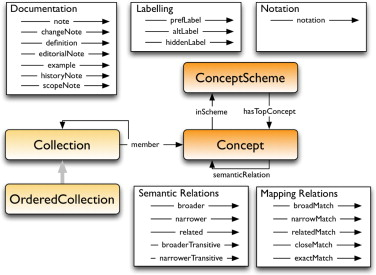

{: .no_toc .text-delta }

<!-- Overlay (only once) -->

  
  

# Introductie tot [SKOS](https://www.w3.org/TR/skos-reference/) (Simple Knowledge Organization System)

SKOS, afgekort voor Simple Knowledge Organization System, is een gestandaardiseerde
manier om kennis te organiseren en te beschrijven op het web. Het biedt een vocabulaire
voor het modelleren van begrippen en hun onderlinge relaties, waardoor het mogelijk is om
semantische structuren te creëren voor het delen en hergebruiken van informatie.

## Thesauri

SKOS is bij uitstek geschikt voor het modelleren en beheren van thesauri, taxonomieën en
andere vormen van gecontroleerde vocabulaires.

- Thesauri: SKOS biedt een gestandaardiseerde manier om thesauri te modelleren,
waardoor complexe conceptuele structuren kunnen worden gedefinieerd en beheerd.
Thesauri kunnen hiermee worden gebruikt voor het indexeren en opzoeken van
informatie.
- Taxonomieën: SKOS maakt het mogelijk om hiërarchische taxonomieën te definiëren,
waarbij concepten worden georganiseerd in een boomstructuur van bredere en smallere
begrippen.  
NB Een thesaurus is een gecontroleerd vocabulaire die synoniemen en gerelateerde
termen bevat, terwijl een taxonomie alleen hiërarchische categorieën gebruikt om
concepten te organiseren.
- Ontologieën: Hoewel SKOS geen volledige ontologie-taal is, kan het worden gebruikt als
onderdeel van een bredere ontologie (vb de ceo). Het biedt een eenvoudige manier om
concepten en hun relaties te beschrijven, wat van pas kan komen bij het modelleren van
domeinkennis in uiteenlopende toepassingsgebieden.
- Semantische Interoperabiliteit: SKOS vergemakkelijkt de uitwisseling van semantische
informatie tussen verschillende systemen en domeinen. Door een gemeenschappelijk
vocabulaire te gebruiken voor het modelleren van begrippen en hun relaties, kunnen
systemen beter met elkaar communiceren en informatie beter begrijpen, wat de
uitwisseling en integratie van gegevens bevordert.
- Herbruikbaarheid van Vocabulaires: SKOS kan gebruikt worden voor de herbruikbaarheid
van vocabulaires aan door standaardisatie en consistentie te bieden in de manier waarop
concepten worden gemodelleerd en gedefinieerd. Dit maakt het gemakkelijker om
bestaande vocabulaires te hergebruiken en te integreren in nieuwe toepassingen en
systemen, wat de ontwikkelingstijd verkort en de consistentie van informatie verbetert.

## Model

Figuur 1. Main elements of the SKOS data model.
Baker, Thomas & Bechhofer, Sean & Isaac, Antoine & Miles, Alistair & Schreiber, Guus & Summers, Ed. (2013). Key Choices in the Design of Simple Knowledge Organization System (SKOS). Journal of Web Semantics. 20. 35-49. 10.1016/j.websem.2013.05.001. 

---

## Classes

- `skos:Concept`: een begrip, met labels als benamingen.
- `skos:ConceptScheme`: een samenhangende verzameling concepten, bijvoorbeeld een thesaurus.
- `skos:Collection`: een groepering van concepten of collecties, met leden via `skos:member`.
- `skos:OrderedCollection`: een collectie met een vaste volgorde. `skos:memberList` verwijst naar een RDF-lijst.

`skos:inScheme` koppelt een concept aan een schema. `skos:topConceptOf` koppelt een topconcept aan zijn schema; `skos:hasTopConcept` legt de omgekeerde relatie vast.

## Properties

**1. Labeling**
- `skos:prefLabel`: de &#39;prefLabel&#39; eigenschap specificeert de primaire benaming voor een
concept binnen een bepaalde taal.  
- `skos:altLabel`: de &#39;altLabel&#39; eigenschap geeft alternatieve benamingen voor een concept
binnen een specifieke taal.  
- `skos:hiddenLabel`: de &#39;hiddenLabel&#39; eigenschap wordt gebruikt om alternatieve of minder
gangbare benamingen voor een concept te verbergen in gebruikersinterfaces.  

**2. Notation**
- `skos:notation`: de &#39;notation&#39; eigenschap biedt een gestandaardiseerde notatie voor het
identificeren van concepten.

**3. Semantic Relations**

- `skos:broader`: verwijst naar een breder concept.
- `skos:narrower`: verwijst naar een smaller concept.
- `skos:related`: verbindt inhoudelijk verwante concepten zonder hiërarchische relatie.
- `skos:broaderTransitive` en `skos:narrowerTransitive`: ondersteunen het afleiden van relaties over meerdere hiërarchische stappen.

Bijvoorbeeld: eettafels → tafels → meubels. Via `skos:broaderTransitive` kun je van eettafels naar meubels verwijzen. `skos:broader` zelf is niet transitief.

**4. Mapping Relations**

Met deze relaties verbind je concepten uit verschillende thesauri:

- `skos:exactMatch`: voldoende gelijkwaardig voor uitwisselbaar gebruik in uiteenlopende toepassingen.
- `skos:closeMatch`: voldoende vergelijkbaar voor uitwisselbaar gebruik in sommige toepassingen.
- `skos:broadMatch`: verwijst naar het bredere concept in de andere thesaurus.
- `skos:narrowMatch`: verwijst naar het smallere concept in de andere thesaurus.
- `skos:relatedMatch`: verwijst naar een inhoudelijk verwant concept.

Voorbeeld: `eettafels skos:broadMatch tafels`. De richting loopt van nauw naar breed. Vergelijk altijd de betekenis; gelijke labels zijn geen bewijs voor een match.

**5. Documentation**

- `skos:definition`: de &#39;definition&#39; eigenschap definieert de betekenis van een concept.
- `skos:note`: de &#39;note&#39; eigenschap biedt aanvullende informatie of commentaar over een
concept.
- `skos:scopeNote`: de &#39;scopeNote&#39; eigenschap geeft de context of toepassingsgebied van
een concept aan. NB in de AAT en de CHT heeft de scopeNote de rol van skos:definition
overgenomen.
- `skos:example`: de &#39;example&#39; eigenschap bevat voorbeelden die het gebruik van een
concept verduidelijken.
- `skos:historyNote`: de &#39;historyNote&#39; eigenschap bevat historische informatie met betrekking
tot een concept.
- `skos:editorialNote`: de &#39;editorialNote&#39; eigenschap bevat redactionele opmerkingen met
betrekking tot een concept.
- `skos:changeNote`: de &#39;changeNote&#39; eigenschap biedt informatie over wijzigingen die zijn
aangebracht in een concept.

---

## Uitleg over het gebruik van skos:editorialNote, skos:historyNote en skos:changeNote

Binnen SKOS zijn er verschillende notities beschikbaar om aanvullende informatie te
verstrekken over de concepten die worden gemodelleerd. `skos:editorialNote`,
`skos:historyNote` en `skos:changeNote`.

### 1. skos:editorialNote

De `skos:editorialNote` eigenschap wordt gebruikt om interne opmerkingen te maken over
een concept die specifiek zijn gericht op de beheerders van een thesaurus. Het biedt ruimte
voor aantekeningen en suggesties met betrekking tot de ontwikkeling, aanpassing of
eventuele verbeteringen van een concept, maar is niet bedoeld voor het bredere publiek dat
de thesaurus of taxonomie raadpleegt.

Gebruik: Deze eigenschap is nuttig wanneer er bepaalde redactionele beslissingen moeten
worden genomen of wanneer er opmerkingen zijn over de noodzaak om een concept te
herzien of aan te passen. Zo kan een medewerker bijvoorbeeld aangeven dat een term
verouderd is en mogelijk aan vervanging toe is, of dat er overleg nodig is om de definitie van
een concept te verfijnen.

Voorbeeld van de notitietekst:
> De kenniswerkers beoordelen een voorstel om de betekenis van dit concept aan te passen.

Kenmerk: De notitie is niet bedoeld voor eindgebruikers of voor publicatie, maar puur voor
intern redactioneel gebruik. Het is aan de medewerkers om te beslissen of de opmerkingen
worden opgevolgd en wanneer zij worden verwijderd of gewijzigd.

### 2. skos:historyNote

De `skos:historyNote` eigenschap biedt een middel om de historische context van een
concept vast te leggen. Dit kan nuttige informatie bevatten over de ontwikkeling, evolutie of
verandering van een concept door de tijd heen. Het kan bijvoorbeeld gaan over
veranderingen in de naam, de betekenis of het gebruik van een concept binnen een bepaald
domein.

Gebruik: Deze eigenschap is van belang wanneer een concept over de tijd heen is aangepast,
bijvoorbeeld omdat de betekenis ervan is verschoven of omdat de term zelf is veranderd.

Het biedt de mogelijkheid om de gebruiker inzicht te geven in de achtergrond en
geschiedenis van een concept.

Voorbeeld van de notitietekst:
> Dit begrip verwees oorspronkelijk naar een jachtterrein voor de eigenaar.

Kenmerk: Deze eigenschap kan waardevolle context bieden voor gebruikers die proberen
de ontwikkeling van een concept te begrijpen. Vooral wanneer een term of concept is
verouderd of vervangen, kan deze notitie dienen als een brug naar de huidige terminologie.

### 3. skos:changeNote

De `skos:changeNote` eigenschap legt specifieke wijzigingen vast die zijn aangebracht aan
een concept. Dit kan betrekking hebben op de definitie van het concept, de relaties met
andere concepten, of andere relevante attributen. Het doel van deze notitie is om een
overzicht te bieden van de wijzigingen die zijn doorgevoerd, zodat de evolutie van het
thesaurus kan worden gevolgd.

Gebruik: Deze eigenschap is vooral nuttig in situaties waarin thesaurus actief wordt
beheerd en bijgewerkt. Het kan helpen bij het bijhouden van wijzigingen, zodat zowel
medewerkers als gebruikers een duidelijk overzicht hebben van wat er is aangepast en
waarom.

Voorbeeld van de notitietekst:
> De scope note is aangepast aan de huidige betekenis van hertenkamp.

Kenmerk: De `skos:changeNote` eigenschap maakt het mogelijk om de wijzigingen in de loop
van de tijd te documenteren. Dit is handig voor het beheer van grote thesauri met veel
medewerkers, waar termen en concepten constant evolueren en aangevuld worden.

### Samenvattend:

- `skos:editorialNote` biedt ruimte voor interne redactionele opmerkingen, die helpen bij het
beheer van de thesaurus.
- `skos:historyNote` legt de geschiedenis en ontwikkeling van een concept vast, wat
belangrijk is voor gebruikers die inzicht willen in de evolutie van een term.
- `skos:changeNote` documenteert specifieke wijzigingen die zijn doorgevoerd, wat essentieel
is voor het bijhouden van de aanpassingen binnen een thesaurus.

In PoolParty worden notes opgeslagen als blank nodes.
Bij de RCE voeg je jouw initialen toe, bijvoorbeeld `jvand`.

---
opgenomen van "Uitleg over het gebruik van skos:editorialNote, skos:historyNote en skos:changeNote" - Joop Vanderheiden

## Bronnen

- [W3C SKOS Reference](https://www.w3.org/TR/skos-reference/)
- [W3C SKOS Primer](https://www.w3.org/TR/skos-primer/)
- [RCE: Begrippen, termen en concepten](https://kennis.cultureelerfgoed.nl/index.php/Thesauri_bij_de_RCE_-_Begrippen,_termen_en_concepten)
